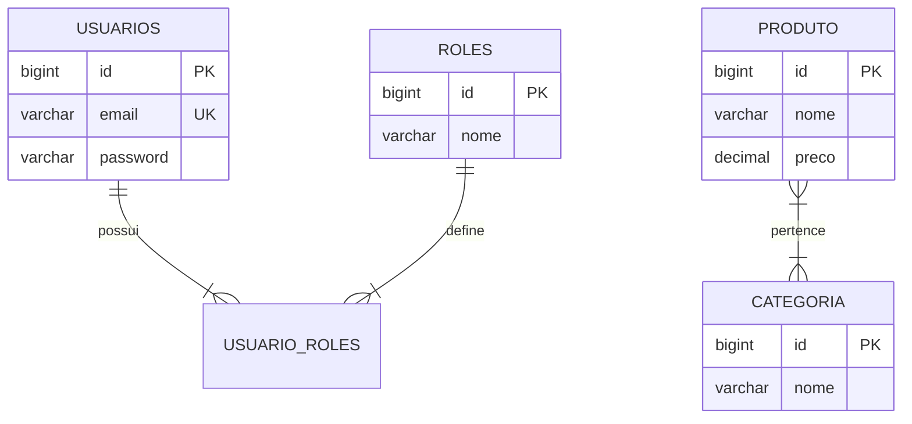

# Sistema de Produtos API

API RESTful desenvolvida com **Java 21** e **Spring Boot** para gerenciamento de produtos, categorias e controle de acesso com autenticação e autorização via **JWT (JSON Web Token)**.

O projeto foi construído seguindo as melhores práticas do ecossistema Spring: arquitetura em camadas, DTO Pattern com Java Records, validações declarativas com Bean Validation, mapeamento desacoplado de objetos, tratamento global de exceções, persistência relacional com Spring Data JPA/Hibernate, segurança stateless com Spring Security e documentação interativa via OpenAPI / Swagger.

---

## 🛠️ Tecnologias Utilizadas

- **Java 21 (LTS)**
- **Spring Boot**
- **Spring Web MVC**
- **Spring Data JPA & Hibernate**
- **Spring Security** (Autenticação Stateless e RBAC)
- **JWT (io.jsonwebtoken / JJWT 0.12.6)**
- **Springdoc OpenAPI (Swagger UI)**
- **MySQL 8** (Banco de dados relacional)
- **Bean Validation (Hibernate Validator)**
- **Lombok**
- **Apache Maven** (com Maven Wrapper `./mvnw`)
- **Docker & Docker Compose**
- **JUnit 5 & Mockito** (Testes unitários automatizados)
- **GitHub Actions** (Pipeline de Integração Contínua - CI)

---

## 🚀 Funcionalidades

### 🔐 Autenticação e Usuários
- Cadastro de novos usuários com role padrão `ROLE_BASIC`.
- Login com credenciais e geração de token JWT assinado com chave HMAC.
- Proteção de senhas com hash criptográfico **BCrypt**.
- Controle de acesso baseado em papéis (**RBAC**): `ROLE_BASIC` e `ROLE_ADMIN`.

### 📦 Produtos
- Cadastro de produto com associação a uma ou mais categorias (*Apenas ADMIN*).
- Atualização completa de produto por ID (*Apenas ADMIN*).
- Exclusão de produto por ID (*Apenas ADMIN*).
- Listagem geral de produtos (com filtros opcionais por categoria, preço mínimo e máximo).
- Consulta de produto por ID.
- Consulta de produtos por nome (busca parcial/insensível a maiúsculas).
- Consulta de produtos por categoria (via Path Variable ou Query Param).
- Consulta com paginação configurável (`Pageable`).
- Consulta por faixa de preço com paginação (`precoMin` e `precoMax`).

### 🏷️ Categorias
- Criação de nova categoria (*Apenas ADMIN*).
- Listagem de todas as categorias cadastradas.
- Consulta de produtos vinculados a uma categoria específica por ID.

---

## 📐 Modelagem de Dados

### Entidades e Relacionamentos



- **Produto ↔ Categoria**: Relacionamento `@ManyToMany` mapeado pela tabela de junção `produto_categorias`.
- **Usuario ↔ Roles**: Relacionamento `@ManyToMany` (`FetchType.EAGER`) mapeado pela tabela `usuario_roles`.
- **Preço**: Definido com `BigDecimal` (`precision = 19, scale = 2`) para garantir precisão monetária.

---

## 🔒 Regras de Segurança e Permissões

A API adota o modelo de segurança **Stateless** gerenciado pelo `SecurityConfiguration`:

| Rota / Endpoint | Método HTTP | Permissão Necessária |
| :--- | :--- | :--- |
| `/auth/register` | `POST` | Pública (Todos) |
| `/auth/login` | `POST` | Pública (Todos) |
| `/v3/api-docs/**`, `/swagger-ui/**`, `/swagger-ui.html` | `GET` | Pública (Documentação) |
| `/produto` | `GET` | Pública (Todos) |
| `/categoria` | `GET` | Pública (Todos) |
| `/produto/{id}` | `GET` | Autenticado (`ROLE_BASIC` ou `ROLE_ADMIN`) |
| `/produto/pagina`, `/produto/pagina/{page}` | `GET` | Autenticado (`ROLE_BASIC` ou `ROLE_ADMIN`) |
| `/produto/nome/{nome}` | `GET` | Autenticado (`ROLE_BASIC` ou `ROLE_ADMIN`) |
| `/produto/categoria`, `/produto/categoria/{categoria}` | `GET` | Autenticado (`ROLE_BASIC` ou `ROLE_ADMIN`) |
| `/produto/faixa-preco`, `/produto/faixa-preco/{min}/{max}`| `GET` | Autenticado (`ROLE_BASIC` ou `ROLE_ADMIN`) |
| `/categoria/{id}` | `GET` | Autenticado (`ROLE_BASIC` ou `ROLE_ADMIN`) |
| `/produto` | `POST` | Exclusivo `ROLE_ADMIN` |
| `/produto/{id}` | `PUT` | Exclusivo `ROLE_ADMIN` |
| `/produto/{id}` | `DELETE` | Exclusivo `ROLE_ADMIN` |
| `/categoria` | `POST` | Exclusivo `ROLE_ADMIN` |

> [!NOTE]
> Para acessar rotas autenticadas, informe o cabeçalho HTTP:
> `Authorization: Bearer <seu_token_jwt>`

---

## 📑 Documentação da API

### 1. Autenticação (`/auth`)

#### Registrar Usuário
- **POST** `/auth/register`
- **Body:**
```json
{
  "email": "usuario@exemplo.com",
  "password": "senhaSegura123"
}
```
- **Resposta (`201 Created`):**
```text
usuarioCriado
```

#### Realizar Login
- **POST** `/auth/login`
- **Body:**
```json
{
  "email": "usuario@exemplo.com",
  "password": "senhaSegura123"
}
```
- **Resposta (`200 OK`):**
```json
{
  "token": "eyJhbGciOiJIUzI1NiIsInR5cCI6IkpXVCJ9...",
  "expiresIn": 3600000
}
```

---

### 2. Produtos (`/produto`)

#### Criar Produto (Requer `ROLE_ADMIN`)
- **POST** `/produto`
- **Body:**
```json
{
  "nome": "Smartphone Galaxy",
  "preco": 1999.90,
  "categoriasIds": [1, 2]
}
```
- **Resposta (`200 OK`):**
```json
{
  "id": 1,
  "nome": "Smartphone Galaxy",
  "preco": 1999.90,
  "categorias": [
    "Eletrônicos",
    "Smartphones"
  ]
}
```

#### Listar Produtos com Filtros Opcionais
- **GET** `/produto?categoria=Eletronicos&precoMin=1000&precoMax=3000`

#### Listar Produtos Paginados
- **GET** `/produto/pagina?page=0&size=10&sort=id,asc`
- **GET** `/produto/pagina/1` (Página 1 com tamanho padrão de 10 itens)

#### Buscar por ID
- **GET** `/produto/{id}`

#### Buscar por Nome
- **GET** `/produto/nome/{nome}`

#### Buscar por Faixa de Preço (com paginação)
- **GET** `/produto/faixa-preco?precoMin=100.00&precoMax=500.00`
- **GET** `/produto/faixa-preco/100.00/500.00`

#### Atualizar Produto (Requer `ROLE_ADMIN`)
- **PUT** `/produto/{id}`
- **Body:**
```json
{
  "nome": "Smartphone Galaxy Pro",
  "preco": 2299.90,
  "categoriasIds": [1]
}
```

#### Deletar Produto (Requer `ROLE_ADMIN`)
- **DELETE** `/produto/{id}`
- **Resposta:** `204 No Content`

---

### 3. Categorias (`/categoria`)

#### Criar Categoria (Requer `ROLE_ADMIN`)
- **POST** `/categoria`
- **Body:**
```json
{
  "nome": "Informática"
}
```
- **Resposta (`200 OK`):**
```json
{
  "id": 1,
  "nome": "Informática"
}
```

#### Listar Categorias
- **GET** `/categoria`
- **Resposta (`200 OK`):**
```json
[
  {
    "id": 1,
    "nome": "Informática"
  }
]
```

#### Consultar Produtos de uma Categoria
- **GET** `/categoria/{id}`
- **Resposta (`200 OK`):**
```json
[
  {
    "id": 1,
    "nome": "Notebook Dell",
    "preco": 3500.00
  }
]
```

---

## 📖 Swagger / OpenAPI

Com a aplicação em execução, a documentação interativa e testes de endpoints ficam disponíveis em:

- **Swagger UI:** `http://localhost:8080/swagger-ui.html`
- **OpenAPI JSON Docs:** `http://localhost:8080/v3/api-docs`

---

## 💻 Como Executar o Projeto

### Pré-requisitos
- **Java 21 (JDK)** instalado e configurado no `JAVA_HOME`.
- **Docker** e **Docker Compose**.
- **Maven** (opcional, o repositório inclui o Maven Wrapper `./mvnw`).

---

### Passo 1: Iniciar o Banco de Dados (MySQL)
O banco de dados relacional roda conteinerizado via Docker Compose:

```bash
docker compose -f docker/docker-compose.yml up -d
```

> Caso queira interromper o container do banco posteriormente:
> ```bash
> docker compose -f docker/docker-compose.yml down
> ```

---

### Passo 2: Executar a Aplicação Spring Boot

Certifique-se de conceder permissão de execução ao Maven Wrapper e execute:

```bash
chmod +x mvnw
./mvnw spring-boot:run
```

A API iniciará na porta padrão `8080` (`http://localhost:8080`).

---

### Passo 3: Executar a Suíte de Testes Automatizados

O projeto conta com testes unitários cobrindo as regras de negócio dos serviços com **JUnit 5** e **Mockito**:

```bash
./mvnw test
```

---

## ⚙️ Variáveis de Ambiente e Configurações

As configurações do sistema residem em `src/main/resources/application.properties` e podem ser sobrescritas por variáveis de ambiente:

| Propriedade / Variável | Descrição | Padrão |
| :--- | :--- | :--- |
| `spring.datasource.url` | URL de conexão JDBC ao MySQL | `jdbc:mysql://localhost:3306/SistemaProdutos` |
| `spring.datasource.username` | Usuário do banco de dados | `root` |
| `spring.datasource.password` | Senha do banco de dados | `123` |
| `JWT.KEY` | Chave secreta de assinatura HMAC do token JWT | Chave pré-configurada |
| `JWT.EXPIRATION` | Tempo de expiração do token em milissegundos | `3600000` (1 hora) |

---

## 🏗️ Estrutura do Projeto

```text
produtos-api/
├── .github/
│   └── workflows/
│       └── ci.yml               # Pipeline de CI (Build e Test no GitHub Actions)
├── docker/
│   └── docker-compose.yml       # Orquestração do container MySQL
├── src/
│   ├── main/
│   │   ├── java/com/bruno/sistemaProdutos/
│   │   │   ├── config/          # Filtros e configurações de segurança e JWT
│   │   │   ├── controller/      # Controladores REST expostos pela API
│   │   │   ├── dto/             # Records de entrada/saída (Requests e Responses)
│   │   │   ├── entity/          # Entidades JPA (Produto, Categoria, Usuario, Roles)
│   │   │   ├── enums/           # Enums do domínio (Role: ROLE_BASIC, ROLE_ADMIN)
│   │   │   ├── exception/       # Exceções customizadas e payload de erros
│   │   │   ├── handler/         # GlobalExceptionHandler (@ControllerAdvice)
│   │   │   ├── mapper/          # Conversores entre entidades e DTOs
│   │   │   ├── repository/      # Interfaces de persistência Spring Data JPA
│   │   │   ├── service/         # Camada de lógica de negócio e autenticação
│   │   │   └── SistemaProdutosApplication.java
│   │   └── resources/
│   │       └── application.properties
│   └── test/
│       └── java/com/bruno/sistemaProdutos/
│           ├── service/         # Testes unitários com JUnit 5 e Mockito
│           └── SistemaProdutosApplicationTests.java
├── mvnw
├── mvnw.cmd
├── pom.xml
└── README.md
```

---

## 🎯 Próximas Evoluções

- [ ] Maior cobertura de testes
- [ ] Testes de integração de ponta a ponta com **MockMvc** e **Testcontainers**.
- [ ] Criação de `Dockerfile` multi-stage para containerização completa da API.
- [ ] Integração do compose da API junto ao banco de dados no Docker Compose.
- [ ] Implementação de pipeline de Continuous Deployment (CD).
- [ ] Cache distribuído com Redis para consultas frequentes de produtos e categorias.
